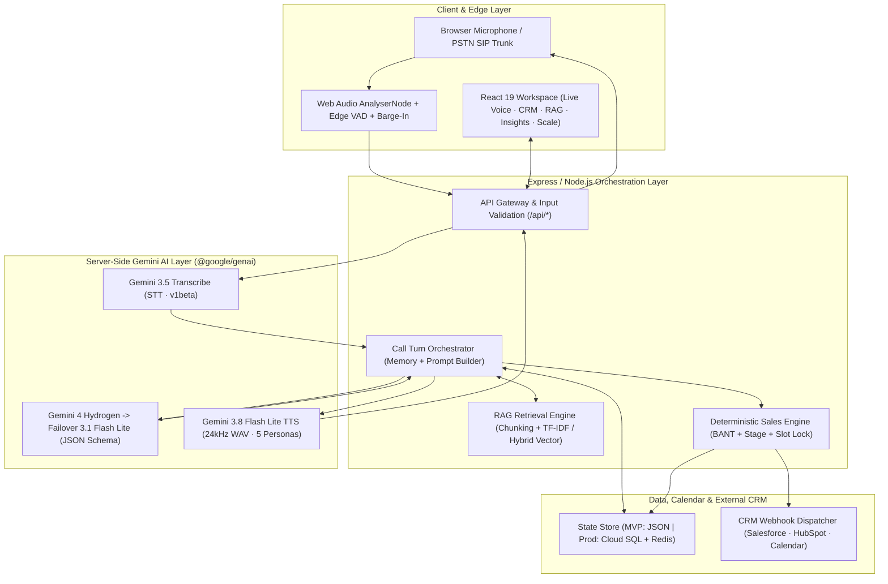
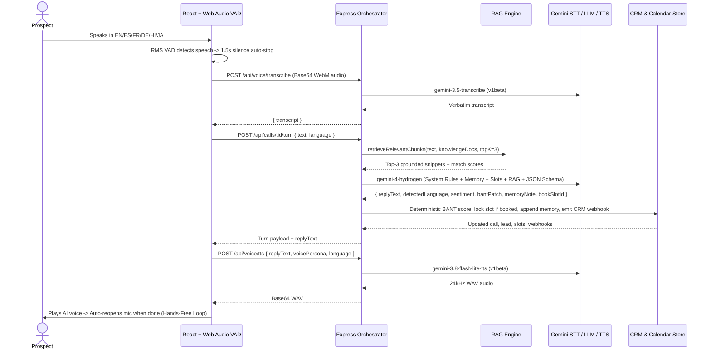
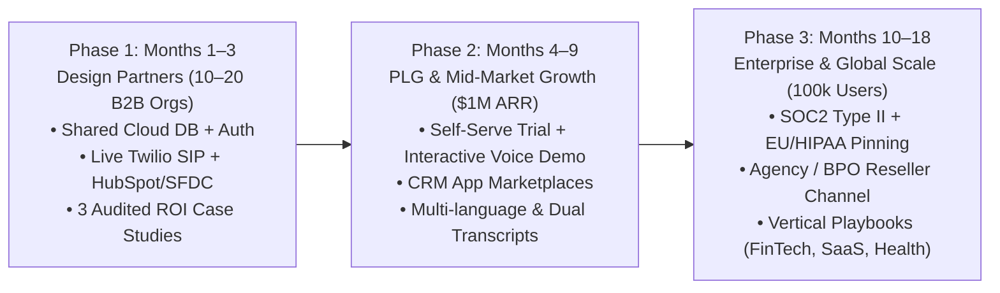
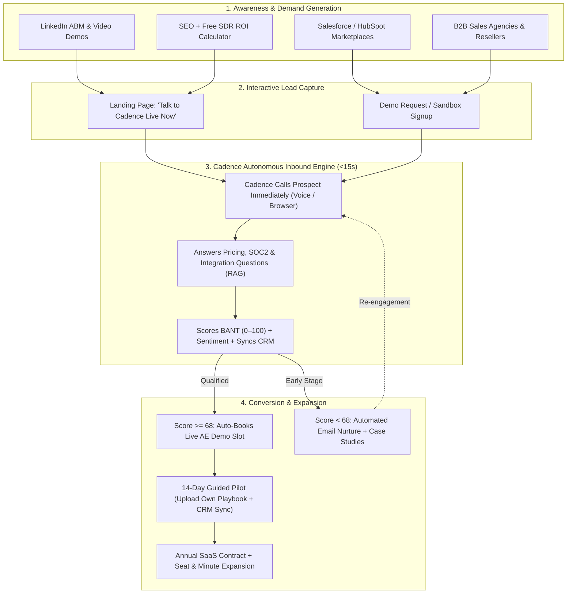
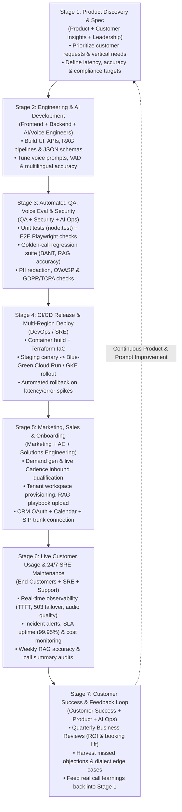
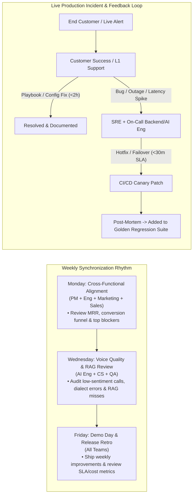

# Cadence — Complete Technical, Business Growth, Marketing & End-to-End Company Operating Blueprint

**Prepared by:** Lead Product & Systems Developer  
**Product:** Cadence — Autonomous AI Sales Voice Agent  
**Audience:** Company Leadership, Engineering, Product, Marketing, Sales & Operations  

---

## Table of Contents
1. [Part 1: Developer Version — Architecture, Tech Stack & Engineering Deep Dive](#part-1-developer-version--architecture-tech-stack--engineering-deep-dive)
2. [Part 2: Business Perspective — Company Growth, SaaS Model & Scaling Plan](#part-2-business-perspective--company-growth-saas-model--scaling-plan)
3. [Part 3: Marketing & Go-To-Market Strategy & Workflow](#part-3-marketing--go-to-market-strategy--workflow)
4. [Part 4: End-to-End Company Workflow (Development → Maintenance → End Customer)](#part-4-end-to-end-company-workflow-development--maintenance--end-customer)
5. [Part 5: Teams, Roles & Cross-Functional Coordination Matrix](#part-5-teams-roles--cross-functional-coordination-matrix)

---

# Part 1: Developer Version — Architecture, Tech Stack & Engineering Deep Dive

As the developer building **Cadence** inside our company, I designed the system to be modular, type-safe, testable, and immediately extensible from a fast MVP into a multi-tenant enterprise SaaS serving 100,000+ active users.

## 1.1 Tech Stack & Engineering Rationale

| Layer | Technology Implemented (Current MVP) | Why It Was Chosen | Production Scale Upgrade (100k+ Users) |
| :--- | :--- | :--- | :--- |
| **Frontend SPA** | **React 19, TypeScript, Vite 8, Tailwind CSS v4, Lucide Icons** | Strict compile-time contracts (`src/types.ts`) shared with the backend; fast modular workspace views without CSS runtime bloat. | Multi-tenant RBAC workspace behind CDN (Cloudflare / Cloud CDN) with SSO (SAML/OIDC). |
| **Client Audio & VAD** | **Web Audio API (`AnalyserNode`), `MediaRecorder`, Web Speech API fallback** | Zero telephony fees for browser testing; real-time microphone amplitude visualization, hands-free RMS Voice Activity Detection (1.5s silence auto-endpointing), and barge-in interruption. | **WebRTC + Twilio Elastic SIP Trunking + LiveKit** for direct PSTN phone dialing and full-duplex audio. |
| **Backend Orchestrator** | **Node.js 22, Express 4, TypeScript (`server.ts`)** | Keeps `GEMINI_API_KEY` strictly server-side, centralizes validation and state mutations, runs natively via `node server.ts` on Cloud Run, and shares deterministic engines with tests. | Stateless **GKE Autopilot / Cloud Run** pods split into Voice Gateway Pods (120 streams/pod) and Orchestrator Pods (85 streams/pod). |
| **AI Voice & Reasoning** | **`@google/genai` SDK** (`gemini-3.5-transcribe`, `gemini-4-hydrogen` / `gemini-3.1-flash-lite`, `gemini-3.8-flash-lite-tts`) | Unified multimodal API with strict JSON `responseSchema`, multilingual fluency (6 languages), low-thinking latency tuning, and automatic retry + model failover. | **Gemini Live API** bidirectional audio streaming + Vertex AI Provisioned Throughput to cut end-to-end turn latency to ~420 ms. |
| **RAG Knowledge Engine** | **Custom Deterministic TF-IDF + Cosine Similarity (`src/lib/ragEngine.ts`)** | Zero external infra setup, millisecond chunk retrieval, acronym boosting (`SOC2`, `GDPR`, `HIPAA`, `CRM`), transparent match percentages, and full unit-test coverage. | **Hybrid BM25 + Multilingual Dense Embeddings (`pgvector` / Qdrant)** + Redis semantic cache (~68% cache hit rate on pricing/security FAQs). |
| **Sales & Qualification Engine** | **Pure TypeScript Logic (`src/lib/salesEngine.ts`) + `node:test`** | Keeps BANT scoring (`0–100`), stage transitions, ARR estimation, slot locking, and scale unit economics 100% deterministic—never trusting LLM math. | Tenant-configurable scoring rubrics stored in PostgreSQL with versioned audit history. |
| **Persistence & Sync** | **JSON File Store (`data/cadence-store.json`) + Simulated CRM Webhooks** | Instant zero-config prototype persistence and one-click demo reset (`/api/reset`). | **PostgreSQL (Cloud SQL)** for leads/calls/bookings + **Redis Cluster** for active call memory + **Cloud Tasks / BullMQ** for idempotent Salesforce/HubSpot webhooks + **GCS/S3** for encrypted audio. |

---

## 1.2 Technical Architecture Diagram

---

## 1.3 Real-Time Voice Turn Execution Sequence

One of the strongest technical design decisions in Cadence is **single-pass structured reasoning**: instead of running separate LLM calls for chat reply, sentiment analysis, BANT extraction, memory extraction, and appointment booking (which would multiply latency and cost by 5×), Cadence extracts **all of them in a single schema-enforced JSON response**.

---

## 1.4 Key Engineering Safeguards Already Built

1. **Zero Client-Side Secret Exposure:** All Gemini calls happen strictly in `src/server/geminiService.ts` via server-side `process.env.GEMINI_API_KEY`.
2. **Automatic Retry & Model Failover:** Transient `503 UNAVAILABLE` / `429 RESOURCE_EXHAUSTED` spikes trigger exponential backoff retries and automatic failover (`gemini-4-hydrogen` → `gemini-3.1-flash-lite`; `gemini-3.5-transcribe` → `gemini-4-hydrogen` → `gemini-3.1-flash-lite`).
3. **Graceful Call Lifecycle Handling:** Rapid start/stop clicks are guarded by refs; hanging up immediately without speaking halts mic/TTS instantly and generates a clean `"No Conversation Recorded"` summary without wasting LLM tokens.
4. **Defensive Validation & Error Boundary:** `src/services/api.ts` strictly validates JSON responses; `App.tsx` sanitizes state arrays; `src/main.tsx` wraps the app in a clean `ErrorBoundary`.
5. **Automated Unit Testing (`node:test`):** 10 deterministic tests in `src/lib/ragEngine.test.ts` and `src/lib/salesEngine.test.ts` verify tokenization, chunking, ranking, BANT math, slot allocation, and 100k-user cost modeling.
6. **Known Production Gaps to Close Before Public Launch:**
   - **Shared Cloud Database:** Replace container-local JSON (`data/cadence-store.json`) with PostgreSQL/Firestore + Redis so calls survive Cloud Run restarts and sync live across team members.
   - **Dual-Language Transcripts:** Store both verbatim local-language text (for legal/compliance audit) and English translation (for global sales managers), paired with multilingual vector RAG embeddings.
   - **Streaming Voice Transport:** Replace REST turn chunks with WebRTC + Gemini Live API for natural <500 ms conversational pacing.

---

# Part 2: Business Perspective — Company Growth, SaaS Model & Scaling Plan

## 2.1 How This Project Directly Drives Company Growth

Cadence creates **two compounding revenue engines** for our company:

### Engine 1: Internal Revenue Accelerator (Using Cadence Ourselves)
- **Sub-15-Second Speed-to-Lead:** Every website inquiry or ad lead gets a live, intelligent voice callback within seconds instead of waiting hours—historically lifting lead-to-demo conversion by **2×–3.4×**.
- **24/7 Global Coverage Without Hiring Night Shifts:** Qualifies prospects across US, EU, LATAM, India, and Japan in their native languages while our human Account Executives focus exclusively on closing high-score, pre-booked enterprise demos.
- **80%+ Lower Cost per Qualified Meeting:** Eliminates repetitive top-of-funnel cold/inbound screening costs.

### Engine 2: High-Margin Commercial B2B SaaS Product
We package Cadence as a **multi-tenant SaaS platform** sold to other B2B companies (SaaS, FinTech, Logistics, Real Estate, EdTech, HealthTech, Agencies) who face the exact same SDR bottleneck.

---

## 2.2 SaaS Packaging, Pricing & Unit Economics

### SaaS Pricing Architecture (Hybrid Seat + Usage Model)

| Tier | Target Segment | Monthly Price | Included Capabilities | Target Gross Margin |
| :--- | :--- | :--- | :--- | :---: |
| **Starter** | Startups & small sales teams (up to 25 reps) | **$29 / seat / mo** (or **$499/mo base** + 2,500 voice mins) | 2,500 autonomous minutes, 1 Knowledge Base, Google Calendar sync, Email/Slack summaries | ~65% |
| **Growth** | Mid-market revenue teams (25–150 reps) | **$38 / seat / mo** + **$0.14 / extra min** | Unlimited RAG playbooks, 12 languages, Salesforce & HubSpot bi-directional sync, BANT + Sentiment analytics | ~71% |
| **Enterprise** | Large orgs (100–500+ reps, multi-region) | **Custom ARR ($30k–$250k+/yr)** (15%–22% volume discounts) | Dedicated SIP trunks, custom brand voice personas, EU Frankfurt GDPR pinning, SOC2/HIPAA BAA, 99.95% SLA | ~76%+ |

### Unit Economics & 3-Year Revenue / Profit Scaling Model

Validated against our engineering cost engine (`computeScaleProjection` in `src/lib/salesEngine.ts` at 2.4 calls/user/mo × 4.5 min = 10.8 min/user/mo; `$0.14/min` blended revenue rate):

| Metric | Year 1 — Pilot & PMF (10,000 Active Users) | Year 2 — Growth Scale (50,000 Active Users) | Year 3 — Enterprise Scale (100,000 Active Users) |
| :--- | ---: | ---: | ---: |
| **Monthly Voice Volume** | 24,000 calls (108k mins) | 120,000 calls (540k mins) | 240,000 calls (1.08M mins) |
| **Monthly Revenue (MRR)** | **$15,120 / mo** | **$75,600 / mo** | **$151,200 / mo** |
| **Annualized Run-Rate (ARR)** | **$181,440 / yr** | **$907,200 / yr** | **$1,814,400 / yr** |
| **Direct COGS (STT+LLM+TTS+SIP+Cloud)** | $5,750 / mo ($0.0532/min) | $23,426 / mo ($0.0434/min) | $44,119 / mo ($0.0409/min) |
| **Monthly Gross Profit (Margin)** | **$9,370 / mo (62.0%)** | **$52,174 / mo (69.0%)** | **$107,081 / mo (70.8%)** |
| **Estimated Fixed OpEx (Team + GTM)** | $8,000 / mo | $22,000 / mo | $38,000 / mo |
| **Estimated Net Profit (EBITDA)** | **$1,370 / mo ($16.4k/yr)** | **$30,174 / mo ($362k/yr)** | **$69,081 / mo ($829k/yr)** |
| **Customer Savings vs Human SDRs** | $637,750 / mo saved | $3,168,074 / mo saved | $6,338,881 / mo saved |

---

## 2.3 Phased Business Scaling Roadmap

1. **Phase 1 — Design Partners & Proof (Months 1–3):** Sign 10–20 pilot B2B teams at discounted annual contracts. Measure real metrics (speed-to-lead, qualified demo lift, cost per meeting) to publish ironclad ROI case studies.
2. **Phase 2 — Product-Led Growth & CRM Ecosystems (Months 4–9):** Launch a self-serve Growth plan with instant website widget testing, publish native apps on **Salesforce AppExchange** and **HubSpot Marketplace**, and expand outbound ABM.
3. **Phase 3 — Enterprise & Partner Channel Multiplication (Months 10–18):** Complete SOC2 Type II certification, offer white-label reseller tiers to B2B lead-gen agencies and BPOs (each agency brings 20–100 downstream clients at near-zero CAC), and expand multi-region infrastructure.

---

# Part 3: Marketing & Go-To-Market Strategy & Workflow

## 3.1 Positioning & Ideal Customer Profile (ICP)
- **Positioning Statement:** *"Cadence calls every inbound lead in under 15 seconds, qualifies them in their native language using your exact sales playbook, and books ready-to-close demos directly onto your Account Executives' calendars."*
- **Primary Buyers:** VP of Sales, Chief Revenue Officer (CRO), Head of Revenue Operations (RevOps), and Founders of B2B companies spending $20k+/month on paid leads or SDR teams.
- **Top Acquisition Channels:**
  1. **"Call Me Now" Interactive Live Demo (Signature Growth Lever):** Put a widget on our landing page where any visitor enters their number or clicks their browser mic and **Cadence immediately conducts a real live discovery call with them**—proving product quality in 30 seconds.
  2. **LinkedIn Founder & RevOps Content + Account-Based Marketing (ABM):** Side-by-side latency & ROI videos comparing a 3-hour human callback vs. Cadence's 12-second multilingual voice response.
  3. **CRM & Telephony Ecosystem Marketplaces:** Salesforce AppExchange, HubSpot Marketplace, and Twilio Partner Directory capture high-intent buyers already searching for AI sales dialers.
  4. **SEO & ROI Calculators:** Publish our interactive *Human SDR vs. AI Voice Agent Cost Calculator* as a free lead magnet.
  5. **Agency & RevOps Consultancy Partner Program:** 20% recurring revenue share for B2B sales agencies deploying Cadence for their clients.

---

## 3.2 Marketing-to-Revenue Automated Workflow Diagram

Notice how our marketing engine **uses Cadence itself** ("dogfooding") right in the middle of the funnel to maximize conversion:

### Core Marketing & SaaS Growth KPIs Tracked Weekly
- **Top-of-Funnel:** Qualified website visitors, live voice demo starts, MQLs by channel.
- **Conversion:** Speed-to-lead (<15s), Voice-to-Demo booking rate (target: 22–30%), Pilot-to-Paid conversion (target: 35–45%).
- **SaaS Efficiency:** Customer Acquisition Cost (CAC), **LTV:CAC ratio (target: >4:1)**, CAC Payback Period (target: <6 months), and **Net Revenue Retention / NRR (target: >115% via minute & seat expansion)**.

---

# Part 4: End-to-End Company Workflow (Development → Maintenance → End Customer)

This is the complete operational lifecycle showing how an idea moves from engineering through security, deployment, marketing, customer onboarding, 24/7 maintenance, and back into continuous product improvement.

## 4.1 Full End-to-End Lifecycle Diagram

---

## 4.2 Stage-by-Stage Breakdown

### Stage 1: Product Discovery & Specification
- **Activities:** Analyze real customer call drop-offs, enterprise security RFPs, and CRM feature gaps; write PRDs with clear acceptance criteria (e.g., *"Add dual-language transcript storage with <20ms write overhead"*).
- **Exit Gate:** Approved PRD, UI wireframe, API contract (`types.ts`), and security review checklist.

### Stage 2: Engineering & AI Development
- **Activities:** Parallel tracks across Frontend (React voice UI & dashboards), Backend (Node/Express APIs, PostgreSQL/Redis schemas, CRM webhooks), and AI/Voice Engineering (STT/TTS tuning, RAG embedding ranking, structured prompt optimization).
- **Exit Gate:** Feature branch PR with passing `tsc --noEmit`, unit tests, and peer code review.

### Stage 3: Quality Assurance, AI Evaluation & Security Hardening
- **Activities:**
  - **Deterministic Logic Tests:** Verify BANT scoring, RAG ranking, and slot locking (`node:test`).
  - **AI Evaluation Harness:** Replay 50+ golden multilingual audio recordings to verify STT WER (Word Error Rate), RAG grounding precision, hallucination rate (<1%), and booking accuracy.
  - **Security & Compliance Gate:** Verify TLS/SRTP, PII scrubbing, tenant isolation, and TCPA calling-hour enforcement.
- **Exit Gate:** Zero critical/high bugs and green evaluation scorecard.

### Stage 4: CI/CD Deployment & Infrastructure Release
- **Activities:** Automated GitHub Actions build Docker image → deploy to Staging → run smoke tests (`GET /api/health`, live TTS/STT check) → progressive Blue-Green / Canary rollout (10% → 50% → 100%) on Cloud Run / GKE across US & EU regions.
- **Exit Gate:** Error rate <0.5%, p95 latency within budget, zero crash loops.

### Stage 5: Go-To-Market, Sales & Customer Onboarding (Reaching the End Customer)
- **Activities:**
  1. Marketing attracts prospects and triggers Cadence's live inbound demo.
  2. Account Executives close annual contracts using ROI calculators and pilot metrics.
  3. Solutions Engineers onboard each tenant in **under 48 hours**: upload company playbooks to Knowledge Base, connect Salesforce/HubSpot + Calendar, configure local caller IDs & compliance disclosures, and run 10 test calls before going live.

### Stage 6: Production Operations & Maintenance
- **Activities:**
  - **Real-Time Telemetry:** Track turn latency (`ms`), STT/LLM/TTS API error rates, failover triggers, active concurrent streams, and per-tenant minute consumption.
  - **Incident Response:** PagerDuty alerting on upstream LLM 503 storms or telephony drops; automatic circuit-breaker failover between models and regions.
  - **Routine Maintenance:** Monthly dependency & security patching, model version upgrades (benchmarked against the golden eval suite before promoting), and database backup drills.

### Stage 7: Customer Success, Retention & Continuous Learning
- **Activities:** Review monthly customer dashboards (demos booked, sentiment trends, top objections); help customers refine RAG docs where match scores are low; feed product and language requests directly back into Stage 1 sprint planning.

---

# Part 5: Teams, Roles & Cross-Functional Coordination Matrix

## 5.1 Team Structure (Lean Growth Stage: 8–12 People → Scales Modularly)

| Team / Role | Core Responsibilities | Primary Tools & Artifacts |
| :--- | :--- | :--- |
| **Product Management (PM)** | Owns roadmap, ICP research, pricing/packaging, PRDs, and sprint prioritization. | Linear / Jira, PRDs, Customer Call Insights |
| **Full-Stack / Platform Engineering** | Builds React dashboard, Express/Node orchestrator, PostgreSQL/Redis persistence, and Salesforce/HubSpot/Calendar integrations. | GitHub, TypeScript, React, Express, PostgreSQL |
| **AI / Voice & RAG Engineering** | Optimizes STT/LLM/TTS latency, VAD/barge-in quality, multilingual prompts, JSON schemas, and Hybrid Vector RAG accuracy. | `@google/genai`, Golden Audio Eval Suite, `pgvector` |
| **DevOps / SRE & Security** | Manages Cloud Run/GKE clusters, Terraform IaC, CI/CD pipelines, monitoring/alerts, SOC2/GDPR/TCPA compliance, and cost optimization. | Terraform, GitHub Actions, Cloud Monitoring, WAF |
| **QA & Reliability** | Runs automated unit tests, Playwright UI flows, load testing (simulating 200+ concurrent streams), and regression checks. | `node:test`, Playwright, k6 Load Testing |
| **Marketing & Growth** | Runs LinkedIn ABM, SEO/calculators, live demo funnel, CRM marketplace listings, case studies, and partner recruitment. | HubSpot, LinkedIn Ads, Analytics, Landing Pages |
| **Sales & Solutions Engineering (AE / SE)** | Runs enterprise demos, security questionnaires, 14-day guided pilots, technical CRM/SIP onboarding, and contract closing. | Cadence CRM, Salesforce, Demo Sandboxes |
| **Customer Success & Support (CS)** | Handles tenant playbook optimization, QBRs, ticket triage, SLA communication, and upsell/expansion triggers. | Zendesk/Intercom, Insights Dashboard, QBR Decks |

---

## 5.2 How Teams Coordinate (Weekly Cadence & Escalation Workflow)

### Concrete Coordination Hand-Offs (RACI Highlights)
1. **Feature Launch Hand-Off:** Engineering ships behind a feature flag → QA signs off on staging → DevOps rolls out progressively → PM briefs Marketing & Sales 1 week prior with demo scripts → Marketing publishes launch campaign → CS enables feature for design partners first.
2. **Customer Onboarding Hand-Off:** AE closes deal → triggers automated CRM webhook to SE & CS with prospect's exact BANT & compliance notes captured by Cadence → SE completes CRM/RAG/SIP setup within 48 hours → CS owns ongoing optimization and 30/60/90-day ROI reviews.
3. **AI Quality & Cost Control Hand-Off:** SRE monitors cost-per-minute (`target <= $0.045/min`) and upstream model errors → flags spikes to AI Engineering → AI Engineering tunes caching, VAD thresholds, or model routing (`gemini-4-hydrogen` vs `gemini-3.1-flash-lite`) without disrupting customer calls.

---

## Summary: Why This Blueprint Wins

By combining a **pragmatic, high-margin technical core** (single-pass structured Gemini reasoning, deterministic BANT/booking rules, RAG grounding, and modular scaling to 100,000+ users) with a **self-proving Go-To-Market engine** (where Cadence literally qualifies our own inbound leads live on the website) and a **tight engineering-to-customer operating loop**, our company gains both an immediate internal sales advantage and a scalable SaaS product capable of reaching **$1.8M+ ARR at ~70% gross margins** within 3 years.
