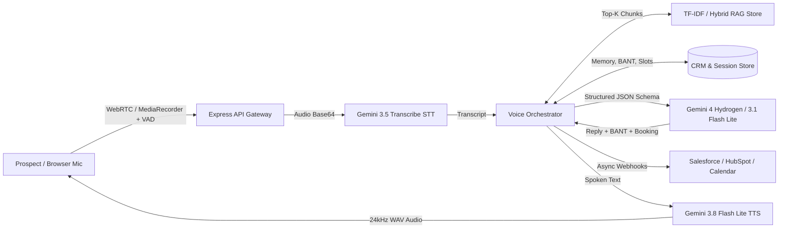

# Cadence — Autonomous AI Sales Voice Agent

**Cadence** is a full-stack, real-time multilingual AI Sales Voice Agent MVP built for B2B revenue teams. It conducts live spoken discovery calls using Speech-to-Text (STT) and Text-to-Speech (TTS), retrieves verified product/compliance answers via Retrieval-Augmented Generation (RAG), qualifies leads in real time using BANT and sentiment scoring, autonomously books demo appointments, syncs CRM webhooks, and generates executive post-call summaries—alongside an interactive 100,000-user scalability and cost blueprint.

---

## Key Capabilities

- **Real-Time Voice Interaction (STT & TTS):** Hands-free microphone capture with live Web Audio amplitude visualization, Voice Activity Detection (VAD) auto-endpointing, barge-in interruption (`Interrupt & Speak`), Gemini Speech-to-Text (`gemini-3.5-transcribe`), optional Browser Web Speech fallback, and 24kHz Gemini Neural TTS (`gemini-3.8-flash-lite-tts`) across 5 voice personas (`Kore`, `Puck`, `Charon`, `Fenrir`, `Zephyr`).
- **Contextual Memory & Multilingual Support:** Retains durable account facts across turns and repeat calls while automatically detecting and responding across **6 languages** (`English`, `Spanish`, `French`, `German`, `Hindi`, `Japanese`).
- **Real-Time BANT Qualification & Sentiment Analysis:** Extracts Budget, Authority, Need, Timeline, team size, estimated ARR, buying signals, objections, and turn-by-turn sentiment (`-1.0` to `+1.0`) with deterministic `0–100` scoring and pipeline stage transitions.
- **Live RAG Knowledge Retrieval:** Indexes company playbooks (pricing, SOC2/GDPR/HIPAA compliance, CRM integrations, SLA, case studies) using paragraph/sentence chunking and TF-IDF cosine similarity with match citations shown per turn.
- **Automated Appointment Booking & CRM Sync:** Autonomously reserves open sales rep calendar slots when prospects confirm a meeting time (or via one-click manual booking) and emits idempotent Salesforce/HubSpot webhook audit events.
- **Call Summarisation & Executive Insights:** Generates structured executive summaries, pain points, handled objections, action items, qualification verdicts, and next-best-actions on hang-up (gracefully handling immediate start/stop calls with no speech).
- **Architecture & 100k-User Scale Blueprint:** Interactive system architecture diagram, end-to-end latency workflow, dynamic 1,000–100,000 user capacity & unit-economics calculator, and security/compliance matrix.

---

## System Architecture



For the full business case, architecture deep dive, scalability plan up to 100,000 users, and financial profit projections, see **[PROJECT_REPORT.md](./PROJECT_REPORT.md)**.

---

## Workspace Views

| View | Description |
| :--- | :--- |
| **Live Voice Agent** | Dial prospects, configure language & voice persona, speak hands-free or via test scenarios, and monitor live BANT, sentiment sparkline, RAG sources, calendar slots, and contextual memory. |
| **CRM & Bookings** | Manage prospect pipeline stages, add new leads, inspect account memory notes, track calendar bookings, and audit Salesforce/HubSpot CRM webhook syncs. |
| **Knowledge Base** | Add or delete RAG documents and test live chunk retrieval scores before dialing. |
| **Insights & Calls** | Review completed call metrics, executive summaries, pain points, action items, and full turn-by-turn transcripts. |
| **Architecture & Scale** | Explore the interactive system architecture diagram, workflow latency trace, 100,000-user cost/ROI calculator, and security/deployment matrix. |

---

## Tech Stack

- **Frontend:** React 19, TypeScript, Vite 8, Tailwind CSS v4, Lucide Icons, Web Audio API (`AnalyserNode` + `MediaRecorder`)
- **Backend:** Node.js, Express 4, TypeScript (`tsx`)
- **AI / Voice SDK:** `@google/genai` (server-side proxy only; zero client-exposed API keys)
  - STT: `gemini-3.5-transcribe` (`v1beta`, with failover)
  - Reasoning & Structured Extraction: `gemini-4-hydrogen` (with retry & failover to `gemini-3.1-flash-lite`)
  - TTS: `gemini-3.8-flash-lite-tts` (`v1beta`, 24kHz WAV)
- **Persistence:** File-backed JSON state store (`data/cadence-store.json`) for zero-setup local persistence (designed to swap cleanly to PostgreSQL + Redis + pgvector in production)
- **Testing:** Node built-in test runner (`node:test`) covering deterministic RAG ranking, BANT scoring, slot allocation, and 100k-user scale math

---

## Project Structure

```text
├── server.ts                         # Express server, REST APIs, Vite dev middleware
├── src/
│   ├── App.tsx                       # Root application shell & state orchestration
│   ├── types.ts                      # Shared TypeScript interfaces (client + server)
│   ├── hooks/
│   │   └── useVoiceEngine.ts         # Mic stream, Web Audio VAD, STT & TTS playback loop
│   ├── services/
│   │   └── api.ts                    # Typed client API wrapper with strict JSON validation
│   ├── lib/
│   │   ├── ragEngine.ts              # Chunking & TF-IDF cosine retrieval engine
│   │   ├── ragEngine.test.ts         # Unit tests for RAG engine
│   │   ├── salesEngine.ts            # BANT scoring, sentiment normalization & scale math
│   │   └── salesEngine.test.ts       # Unit tests for sales & scale logic
│   ├── server/
│   │   ├── geminiService.ts          # Server-side Gemini STT, LLM, Summary & TTS calls
│   │   ├── seedData.ts               # Deterministic enterprise seed prospects, slots & docs
│   │   └── store.ts                  # JSON state persistence (load/save/reset)
│   └── components/
│       ├── Sidebar.tsx               # Navigation rail with live pipeline counters
│       ├── LiveVoiceWorkspace.tsx    # Real-time voice console & right intelligence rail
│       ├── CrmBookingsView.tsx       # Pipeline CRM, lead creation, bookings & webhooks
│       ├── KnowledgeBaseView.tsx     # RAG document management & live retrieval tester
│       ├── InsightsCallsView.tsx     # Post-call executive summaries & call history
│       └── ArchitectureScaleView.tsx # Interactive diagram & 100k-user cost/ROI model
├── PROJECT_REPORT.md                 # Full technical, architectural & commercial report
└── package.json
```

---

## Getting Started

### Prerequisites
- Node.js 20+
- A valid Google Gemini API key (`GEMINI_API_KEY`)

### 1. Install Dependencies
```bash
npm install
```

### 2. Configure Environment Variables
Copy `.env.example` to `.env` and set your Gemini API key:
```bash
cp .env.example .env
```
```env
GEMINI_API_KEY="your_gemini_api_key_here"
APP_URL="http://localhost:3000"
```

### 3. Run Locally (Development)
```bash
npm run dev
```
Open `http://localhost:3000` in Chrome/Edge and allow microphone permission when starting a voice call.

### 4. Build, Lint & Run Unit Tests
```bash
# Type-check
npm run lint

# Run pure-logic unit tests (RAG, BANT, 100k-user scale calculator)
npx tsx --test src/lib/ragEngine.test.ts src/lib/salesEngine.test.ts

# Production build
npm run build
```

---

## Core API Endpoints

| Method | Endpoint | Purpose |
| :--- | :--- | :--- |
| `GET` | `/api/health` | Health check |
| `GET` | `/api/state` | Hydrate leads, calls, slots, knowledge docs, and webhooks |
| `POST` | `/api/reset` | Reset workspace to clean seed state |
| `POST` | `/api/leads` | Create a new CRM prospect and emit `lead.created` webhook |
| `PATCH` | `/api/leads/:id` | Update prospect stage or append contextual memory note |
| `POST` | `/api/calls/start` | Initiate a new multilingual call session with opening greeting |
| `POST` | `/api/calls/:id/turn` | Process prospect utterance → RAG → Gemini JSON → BANT/Sentiment/Booking |
| `POST` | `/api/calls/:id/book` | Book an appointment slot and sync CRM webhook |
| `POST` | `/api/calls/:id/summarize` | End call and generate AI executive summary & CRM sync |
| `POST` | `/api/voice/transcribe` | Server-side Gemini STT audio transcription |
| `POST` | `/api/voice/tts` | Server-side Gemini 24kHz WAV speech synthesis |
| `POST` | `/api/knowledge` | Index a new RAG knowledge document |
| `DELETE` | `/api/knowledge/:id` | Remove a RAG knowledge document |
| `POST` | `/api/knowledge/search` | Test top-K RAG chunk retrieval scores |

---

## Documentation
- **[PROJECT_REPORT.md](./PROJECT_REPORT.md)** — Complete executive report covering business problem, project scope, architecture, end-to-end workflow, scalability to 100,000 users, security/compliance, profit projections, and strategic advantages.
